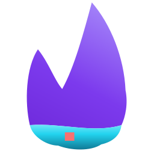
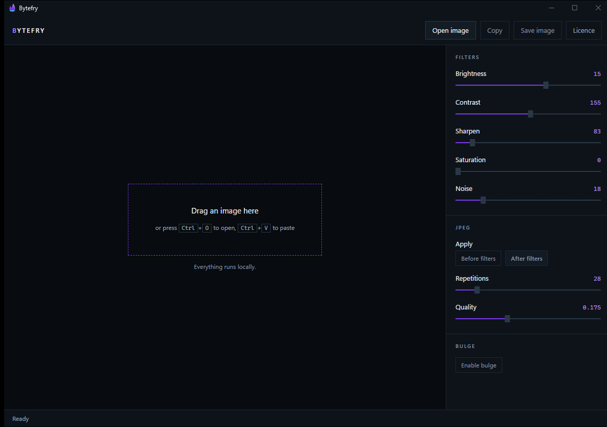

<p align="center">
  
</p>
<h1 align="center">Bytefry</h1>
<p align="center"><strong>Deep-fry an image in a Windows window: repeat-JPEG crush, a WebGL bulge and five filters, all running on your machine, then save.</strong></p>

<p align="center">
  
</p>

Bytefry is a desktop build of *Meme Deep Fryer*: the original image pipeline, running offline in a
WinForms window around Microsoft Edge WebView2.

## Install

Take the per-user installer or the portable x64 archive from
[**releases**](https://github.com/nathwn12/bytefry/releases/latest): one stable release, tagged `bytefry`,
carrying exactly three assets, all 0.1.2's and all built from the immutable `v0.1.2` tag.
[`docs/release-0.1.2.md`](docs/release-0.1.2.md) records their sizes, SHA-256 values and how each was
made. The installer needs no administrator rights, and it keeps its `AppId` across
versions, so a newer version upgrades in place rather than appearing twice. The portable build is
`Bytefry.exe` with its `app\` folder beside it: keep the two together, because the host serves that
folder and nothing else.

Or build it from source:

```powershell
pwsh -File desktop/build.ps1              # desktop\dist\portable\Bytefry.exe + app\ beside it
pwsh -File desktop/build.ps1 -Installer   # plus desktop\dist\installer\Bytefry-<version>-setup.exe
```

Both are self-contained: the .NET 10 runtime travels inside the single executable, so the machine
needs only the Microsoft Edge WebView2 Runtime. `-FrameworkDependent` builds a smaller executable
that needs the .NET 10 Desktop Runtime instead, and `-Runtime win-arm64` publishes ARM64.

## Use it

1. Open an image: `Ctrl+O`, paste one with `Ctrl+V`, or drop a file on the stage.
2. Set the filters. Brightness, contrast, sharpen, saturation and noise each re-render on release.
3. Choose where the JPEG crush runs: before the filters, after them, or both. Repetitions default to 28 at quality 0.175.
4. Enable bulge, then click the image to add a point and drag it to move. Global strength and radius apply to every point.
5. Save with `Ctrl+S`, or copy the result to the clipboard.

The working canvas is capped at 800 px wide. The export is JPEG at 0.8 quality unless "after
filters" is on, in which case it uses the quality slider. Save, Copy and `Ctrl+S` refuse while a
render is running or a point is being dragged, so a half-finished canvas is never encoded; the keys
are in [`app/README.md`](app/README.md).

## Nothing leaves the machine

The page declares `connect-src 'none'`, `form-action 'none'`, `object-src 'none'` and
`base-uri 'none'`, so a fetch, socket or form post from it fails instead of silently succeeding, and
the host cancels every navigation, new window and permission request that would leave its own
virtual origin. There is no analytics, no account, no external image service and no updater: the
filters and the JPEG passes run in the page's canvas and WebGL context, and the image you open and
the file you save are read and written by the window itself. The embedded browser engine is
Windows' own WebView2 Runtime, which Microsoft updates separately from this app.

The app itself writes no registry value, installs no service or scheduled task, and the process runs
as the invoking user. The installer is the one thing that registers the product: it adds the per-user
entry Apps & Features lists, which is what a newer version replaces and what removes the app later.
The portable build never touches it.

## Configure it

| Setting | Where | Default | What it does |
|---|---|---|---|
| `MEME_FRYER_DEV` | environment | unset | `1` turns devtools, context menus and browser accelerators back on |
| `MEME_FRYER_APP_DIR` | environment | `app\` beside the executable | serves a different web-app folder, which must contain `index.html` |
| `MEME_FRYER_USER_DATA_DIR` | environment | a per-user folder the host creates | moves the WebView2 profile; the folder is created if it is missing |

```powershell
$env:MEME_FRYER_DEV = '1'
$env:MEME_FRYER_USER_DATA_DIR = '.\profile'
.\Bytefry.exe
```

Those three variables keep their pre-rename spelling because a shipped install already owns them;
[`docs/naming.md`](docs/naming.md) has the full list of such names and why each one stays.

## Build, test and check

```powershell
pwsh -File desktop/test.ps1                 # window-free suite: bridge, injected script, packaging, CLI
node tests/run.mjs                          # web-layer suite in headless Chrome, no window
node tests/run.mjs export-lock              # one test by name: drop-safety, load-parity, export-lock
node third_party/camanjs/verify.mjs         # shipped CamanJS bytes are the pinned upstream artifact
node third_party/glfx/verify.mjs            # the same for glfx.js, plus the source they came from
python desktop/MemeFryer.Desktop/Assets/make-icon.py --check   # the .ico is a fresh build of assets/icon.svg
pwsh -File desktop/build.ps1 -Verify        # the same build plus the off-screen self-check
```

`node tests/run.mjs` is the gate: correctness checks with no wall-clock assertions, so a busy
machine cannot turn it red. `node tests/bench.mjs` is the optional measurement — numbers only, and
it fails solely on a byte difference, never on a timing one. `-Verify` needs a real window for
WebView2 to compose, so it parks one outside every monitor with `WS_EX_NOACTIVATE`: nothing is
visible and no focus is taken, but it is off-screen, not headless, which is why it stays opt-in. The
icon check needs Python with Pillow and numpy; nothing else here does.

## Requirements

- Windows 10 or later, x64 or ARM64.
- Microsoft Edge WebView2 Runtime, present on Windows 11.
- No .NET runtime for the default self-contained build; `-FrameworkDependent` needs the .NET 10 Desktop Runtime.
- To build: the .NET SDK 10, PowerShell 7, and Inno Setup 6 when you pass `-Installer`.
- For the web-layer suite: Node 22 or newer, which the injected-script check and `node tests/run.mjs` need for a global `WebSocket`.

## Known limits

- Nothing is code-signed, so SmartScreen warns on a fresh download, and there is no auto-update.
- The first launch of the single-file build is slower than later ones: the native WebView2 loader is extracted into the .NET single-file cache on first run.
- The automated suite is window-free. How the rendered pixels look, and how the native Open and Save dialogs draw, need a human look.
- The executable without `app\` shows an error dialog and exits 2.

## Where the details live

| Document | What it covers |
|---|---|
| [`app/README.md`](app/README.md) | the web layer: the pipeline order, the keys, the offline rules, the bridge calls it makes |
| [`desktop/README.md`](desktop/README.md) | the host: bridge contract v1, host policy, build and packaging, what the save can and cannot promise |
| [`docs/naming.md`](docs/naming.md) | Bytefry against the pre-rename names, and which of those stay and why |
| [`docs/release-0.1.3.md`](docs/release-0.1.3.md) | 0.1.3, prepared and not yet published: the window's native title bar, and the source tag it will name |
| [`docs/release-0.1.2.md`](docs/release-0.1.2.md) | 0.1.2, superseded when 0.1.3 is published: its three assets are the stable release's now, with the SHA-256 values read back from the downloads |
| [`docs/release-0.1.1.md`](docs/release-0.1.1.md) | 0.1.1, superseded: what it shipped and the SHA-256 values of the assets it once carried; those three files are no longer downloadable, and the source stays at tag `v0.1.1` |
| [`docs/release-0.1.0.md`](docs/release-0.1.0.md) | 0.1.0, superseded: what it shipped and its SHA-256 values; its page and binaries are gone, and the `v0.1.0` tag is what remains |
| [`CHANGELOG.md`](CHANGELOG.md) | what changed in each version |
| [`third_party/`](third_party) | the vendored CamanJS and glfx.js source, and how each shipped artifact was produced |

## Status

Experimental and still moving. It works today, but it is not a finished product: interfaces may
change, features may be improved or removed, and a release can break the one before it. This is
maintained by one person, not a team. If it breaks,
[open an issue](https://github.com/nathwn12/bytefry/issues) with the command you ran and what you saw.

## Links

- [Releases](https://github.com/nathwn12/bytefry/releases)
- [Issues](https://github.com/nathwn12/bytefry/issues)
- [Changelog](CHANGELOG.md)
- Upstream: [Meme Deep Fryer](https://deepfriedmemes.com) by [Dima](https://dmitry.lol) and
  contributors, [source on GitHub](https://github.com/efskap/deepfriedmemes.com)
- Licence: [GPL-3.0-only](LICENSE) — the upstream licence file grants version 3 and no later version,
  so this build claims none; the release page names its corresponding source, and each version's source
  is its immutable `vX.Y.Z` tag in this repository.
